<div align="center">

# 🎓 UniLink

**A campus opportunity hub for Chulalongkorn University students**

Students discover camps, competitions, jobs, tutoring, freelance work and clubs in one place,
apply in a few clicks, and track every application. Organizers post an opportunity and review applicants
from a single dashboard.


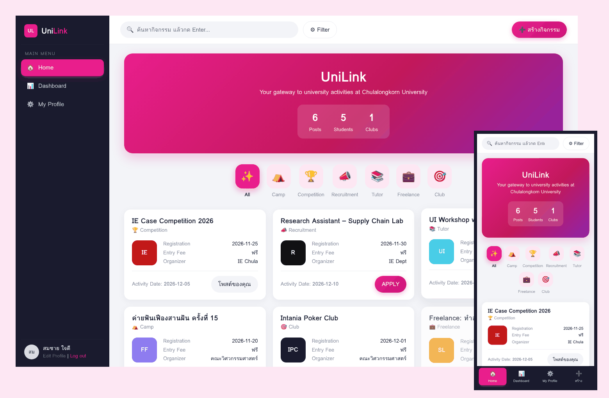

</div>

---

## The problem

Opportunities at Chula are scattered across Facebook groups, LINE chats, Instagram stories and faculty notice boards.
Students miss deadlines because they never see a post. Organizers then collect applications in Google Forms and sort them by hand in spreadsheets.

UniLink puts both sides on one platform:

| Who | Before | With UniLink |
|---|---|---|
| **Students (Applicants)** | Follow dozens of pages and still miss things | One feed with search and filters, one-click apply, and live application status |
| **Organizers (Recruiters)** | Google Form → spreadsheet → manual replies | Post once, add screening questions, accept or decline with a reason |
| **Admins** | No overview | Real-time stats, user and activity moderation |

> Built as a group project for the ComIT course, Faculty of Engineering, Chulalongkorn University.
> The design follows our project report, which covered stakeholder analysis, customer journey maps, a service blueprint, use cases, DFDs and an ER diagram.

---

## Features

### For students
- **Discover** – feed of 6 categories (Camp · Competition · Recruitment · Tutor · Freelance · Club)
- **Search & filter** – keyword search with suggestions, plus filters for category, free/paid, month and organizer, and an option to show only activities still open
- **Apply** – one form that is pre-filled from the student's profile and includes the organizer's screening questions
- **Track** – see each application as Pending, Approved or Rejected. Rejected applications show the reason; approved ones show the organizer's contact
- **Profile** – photo, faculty, skills tags, bio and contact channels. Recruiters see these, together with a portfolio of activities the student was accepted into

### For organizers
- **Post an activity** – guided 5-step form with a **live card preview**, custom cover image, theme colour and screening questions
- **Review applicants** – applicants grouped into Pending, Approved and Rejected, with full profile and answers. Accept, or decline with a written reason
- **Manage** – open/close registration (closes automatically after the deadline), edit, delete

### For admins
- **Real-time dashboard** – user, activity and application counts, most-applied categories, and the latest posts
- **Moderation** – search, edit, change role, suspend (`guest`) or delete users, and edit or remove any activity

---

## Screenshots

| Discover & filter | Activity details |
|---|---|
| 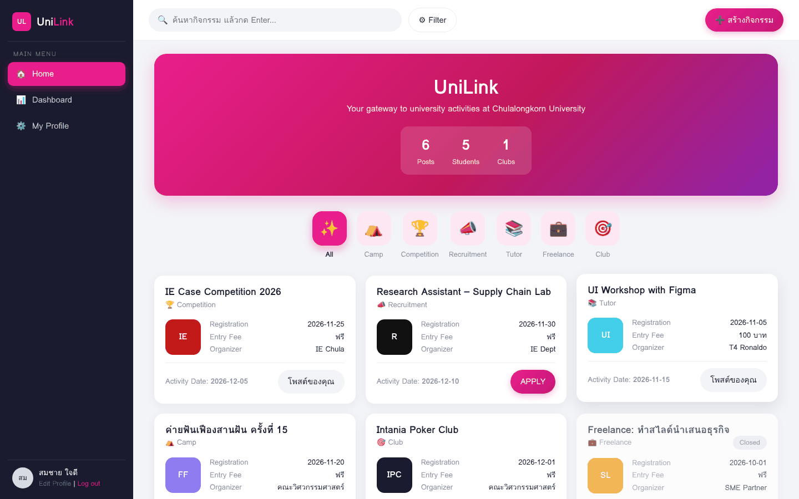 | 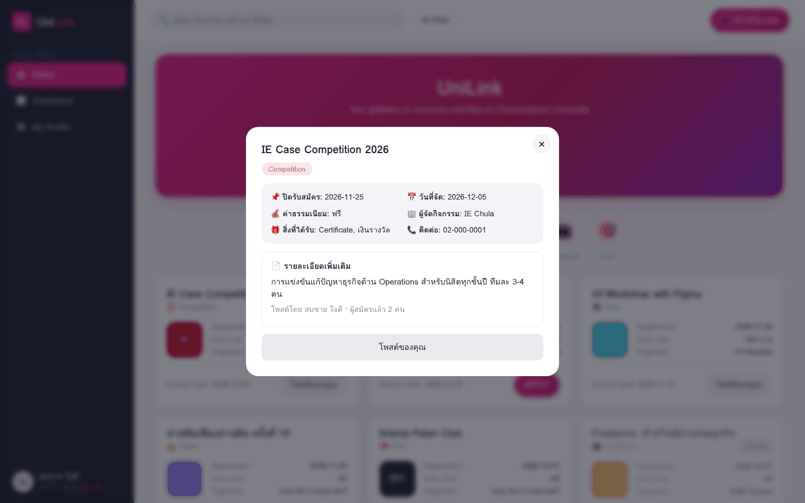 |
| **Post an activity (live preview)** | **Personal dashboard** |
| 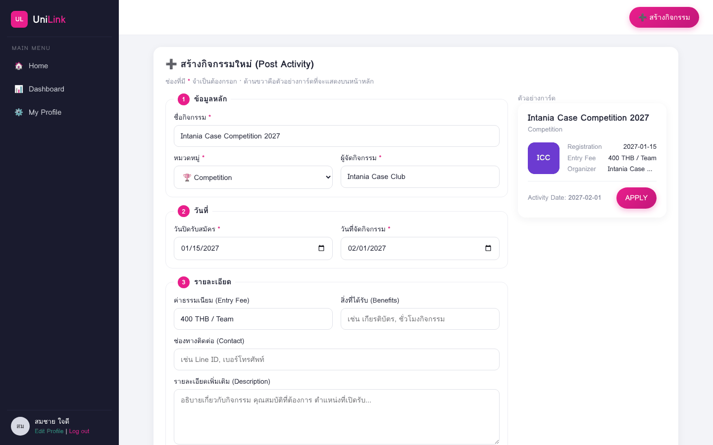 | 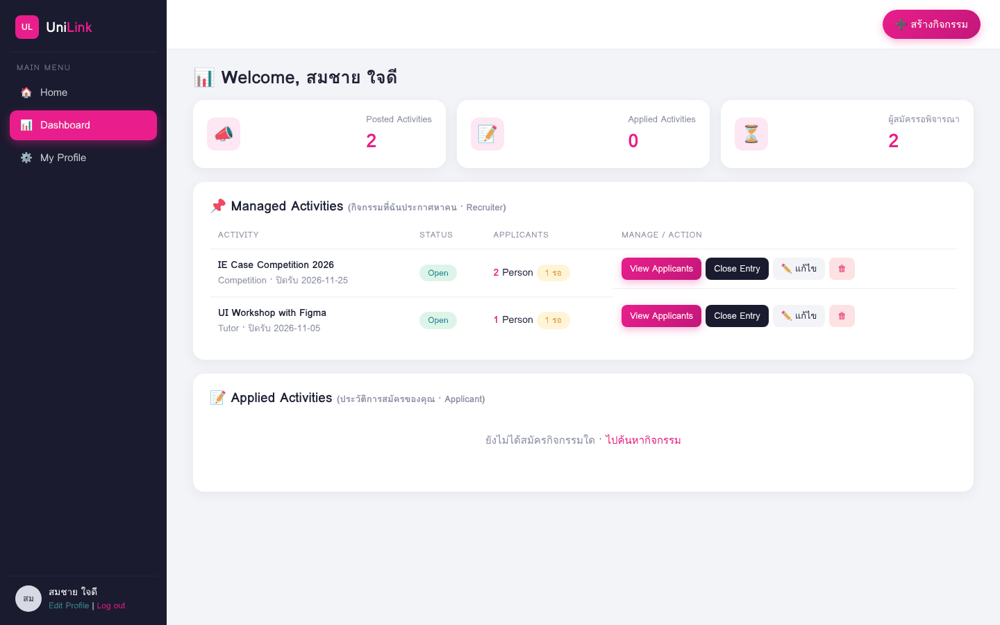 |
| **Review applicants** | **Admin dashboard** |
| 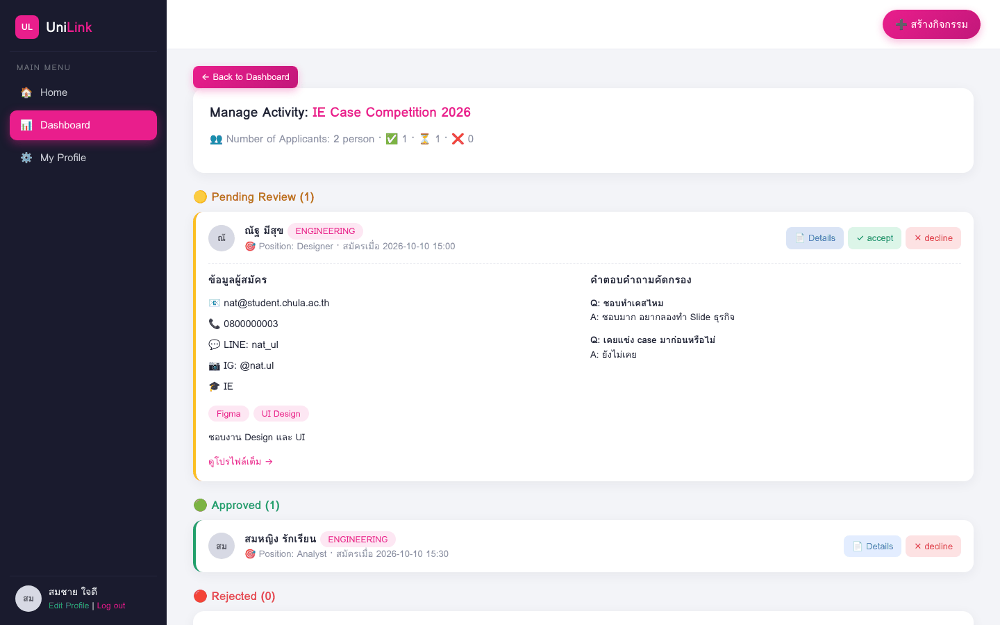 | 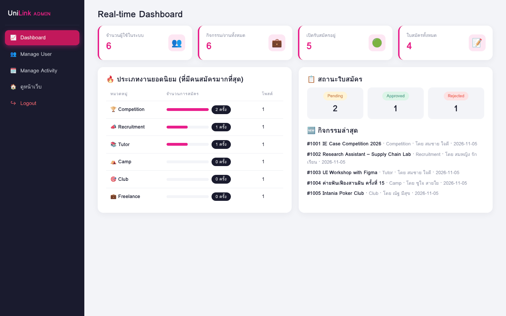 |
| **Sign up (Chula email only)** | **Admin – manage activities** |
| 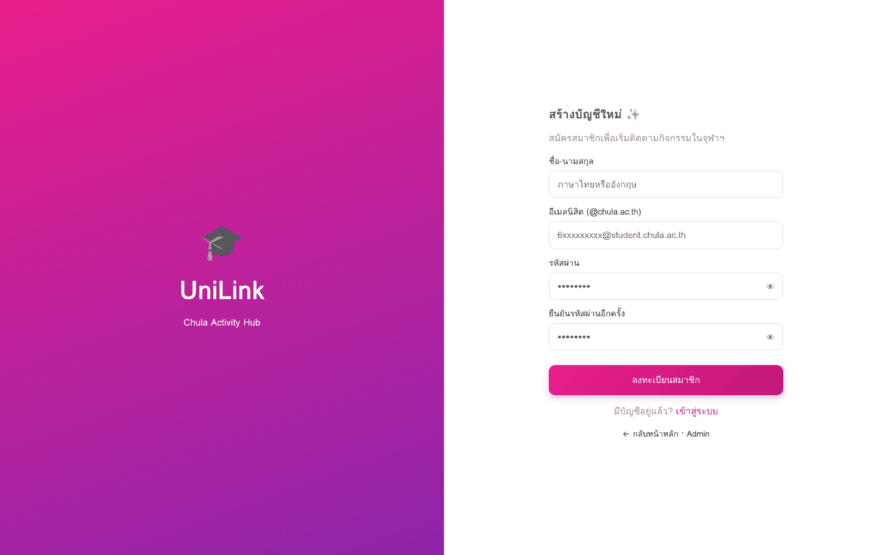 | 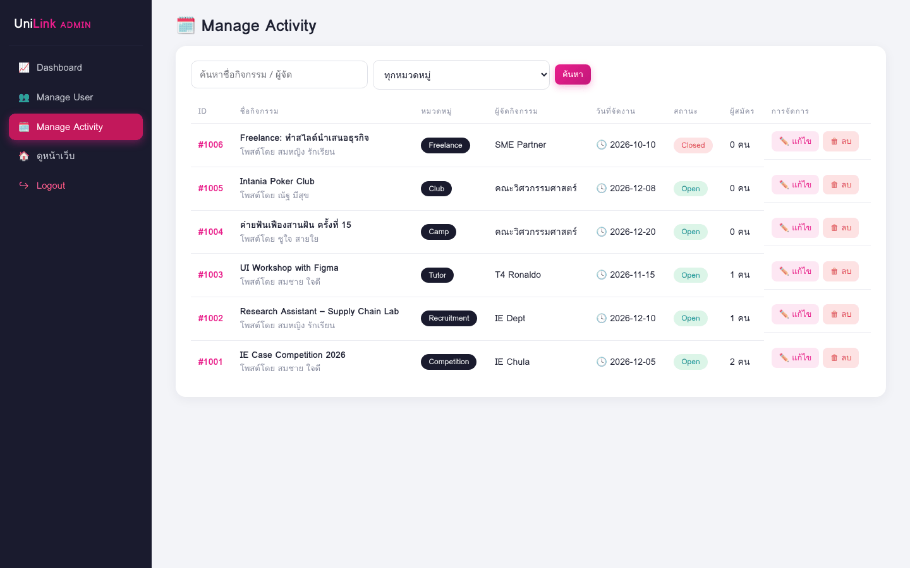 |

**Mobile:** the sidebar becomes a bottom tab bar, and tables become cards.

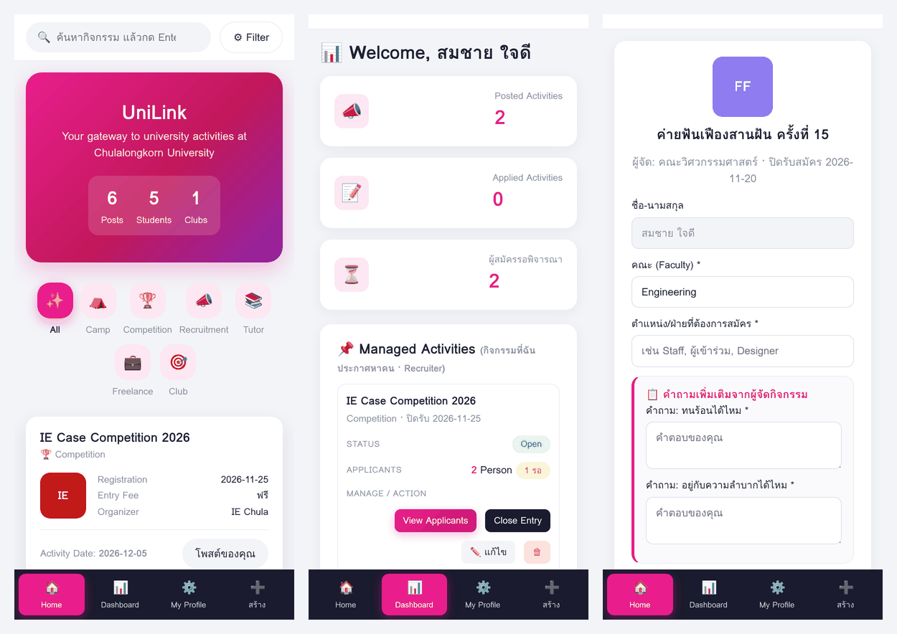

---

## Design decisions driven by user testing

We ran usability tests on the first prototype, rated on a 1–5 scale. The two lowest-scoring tasks drove this version:

| Task (score) | What users struggled with | What changed |
|---|---|---|
| **Create activity (2.2 / 5)** | One long form; unclear which fields were required; no idea how the post would look | Split into **5 numbered steps**, marked required fields `*`, added a **live preview** of the final card, and let users press Enter to add screening questions |
| **Search & filter (3.1 / 5)** | Hard to know whether a filter was applied or how many results matched | Added **autocomplete**, a **result count with a one-click reset**, an "open only" filter, and an active-filter counter on the button |
| **Mobile use** (listed as a limitation) | Desktop-only layout | Fully **responsive**: a bottom navigation bar, and tables that turn into stacked cards |

---

## Tech stack & architecture

| Layer | Choice | Why |
|---|---|---|
| Backend | **PHP 8** (no framework), PDO | Runs on any shared host or XAMPP/MAMP with zero build step |
| Database | **MySQL / MariaDB** (InnoDB, utf8mb4) | Relational data with foreign keys; Thai text support |
| Frontend | Server-rendered HTML, **vanilla JS**, hand-written CSS | Fast and dependency-free; one stylesheet with design tokens |

```
unilink/
├── pages/          # one file per screen (home, apply, dashboard, admin_* …)
├── includes/       # auth, CSRF, uploads, helpers, shared layout
├── config/         # DB connection (auto-detects XAMPP on Windows / MAMP on macOS)
├── assets/         # style.css, app.js
├── database/       # schema + seed data
└── install.php     # one-click DB installer (localhost only)
```

### Data model

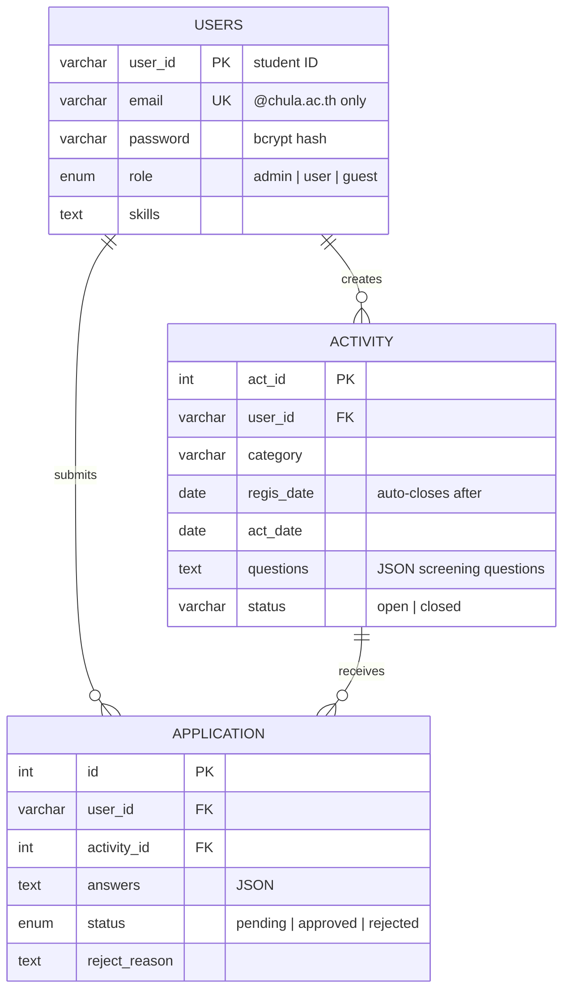

`UNIQUE(user_id, activity_id)` prevents duplicate applications, and `ON DELETE CASCADE` keeps data consistent when a user or post is removed.

### Security
- Passwords hashed with `password_hash` (bcrypt)
- Every query uses **prepared statements** to prevent SQL injection
- All output escaped to prevent XSS, and a **CSRF token** on every form
- Ownership checks on every edit, delete and applicant-review action, and a separate admin role
- Uploads validated as real images (≤ 5 MB) and stored in a folder where PHP execution is blocked
- Session ID regenerated on login, and redirects restricted to internal paths

---

## Run it locally

**Windows – XAMPP**
1. Install [XAMPP](https://www.apachefriends.org), then start **Apache** and **MySQL**
2. Clone into `C:\xampp\htdocs\unilink`
3. Open <http://localhost/unilink/install.php>, then go to <http://localhost/unilink>

**macOS – MAMP**
1. Install [MAMP](https://www.mamp.info), then press **Start**
2. Clone into `/Applications/MAMP/htdocs/unilink`
3. Open <http://localhost:8888/unilink/install.php>, then go to <http://localhost:8888/unilink>

Database credentials are detected automatically (XAMPP `root` / no password, MAMP `root` / `root`). Edit `config/db_settings.php` if yours differ.

**Demo accounts** (fictional seed data)

| Role | Login | Password |
|---|---|---|
| Student / Organizer | `somchai@student.chula.ac.th` | `password123` |
| Admin | `admin_01` (at `/pages/admin_login.php`) | `admin1234` |

Reset to the demo data at any time: `install.php?reset=1`.
